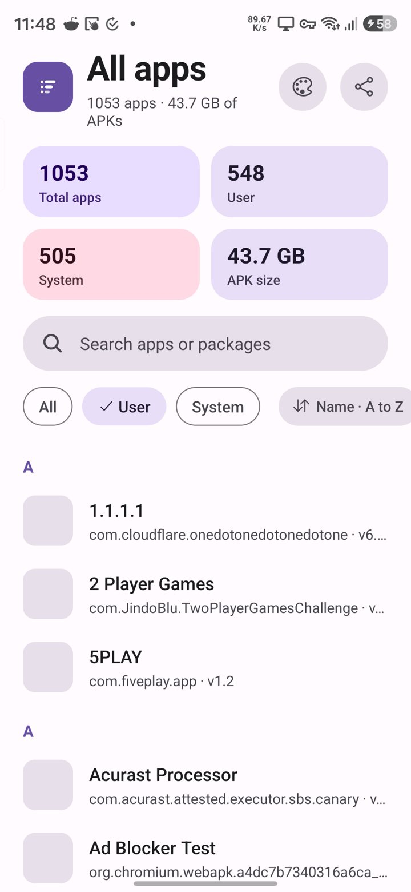

<div align="center">


<h1>App Lister</h1>

<strong>Find, inspect, and export the apps installed on your Android phone.</strong>

<p><strong><a href="https://github.com/Avithegod2010/app-lister/releases/download/v1.2.0/app-lister-v1.2.0.apk">Download APK v1.2.0</a></strong> · <a href="#screenshots">Screenshots</a> · <a href="https://github.com/Avithegod2010/app-lister/releases/tag/v1.2.0">Release notes</a></p>

<sub>Android 7.0 or newer · Includes user and system apps · Works offline</sub>

</div>

## Screenshots

<p align="center">
  <a href="docs/screenshots/home-light.jpg"></a>
  <a href="docs/screenshots/home-dark.jpg"></a>
</p>

<p align="center"><sub>Installed apps · App details</sub></p>

<a name="-features"></a>

## What you can do

- **Find an app.** Search by name or package ID, jump by letter, or filter by user apps, system apps or installer.
- **Inspect the details.** Check the package ID, version, size, installer and update date. Open Android’s App Info directly from the list.
- **Export an inventory.** Share all apps or a selected set as text, CSV or JSON.

<details>
<summary>More ways to browse</summary>

Star favorites, switch between list and grid, or sort by name, install time, update time or APK size. Choose a light, dark or AMOLED theme, use Material You colors and customize icon shapes.

</details>

<a name="-download"></a>

## Install

Download the APK above and open it on your Android phone. Once the app list loads, tap an app for details or long-press a row to select several for export.

<a name="-privacy"></a>

## Privacy and permissions

App Lister reads the installed app list from Android. Browsing and exporting work offline, and exports go through Android’s share menu.

| Access | What it’s for |
| --- | --- |
| Installed apps | Shows user and system packages. |
| Usage access | Optional. Enable it only if you want to see when an app was last used. |

The published APK also declares network permissions in its Android manifest.

<a name="-tech-stack"></a>
<a name="build-it-yourself"></a>

## Build from source

<details>
<summary>Local debug build</summary>

With the Android SDK set up, run:

```bash
npm ci
npx expo prebuild -p android
cd android
./gradlew assembleDebug
```

On Windows, use `gradlew.bat assembleDebug` from the `android` folder. The [EAS preview profile](eas.json) can also build an APK.

The project uses Expo SDK 54, React Native and a [Kotlin module](modules/installed-apps) for Android’s package manager.

</details>

<a name="-credits"></a>
<a name="-license"></a>

## Project links

[Project website](https://avithegod2010.github.io/app-lister/) · [Contributing](CONTRIBUTING.md) · [MIT license](LICENSE)

Inspired by the app list in [Inure App Manager](https://github.com/Hamza417/Inure).
