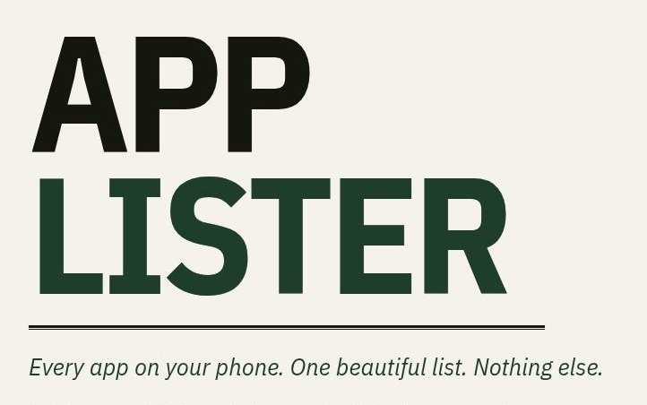
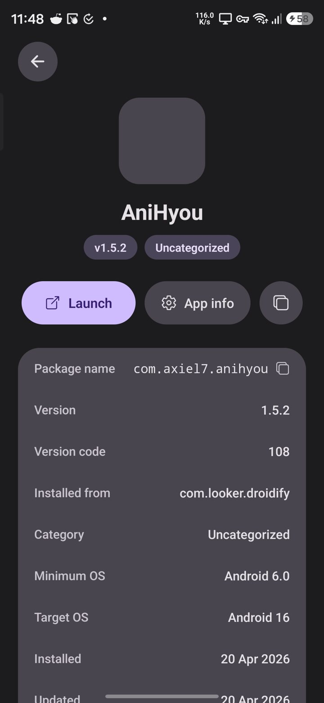

<div align="center">


<h1>App Lister</h1>

<p><strong>Find, inspect and export the apps installed on your Android phone.</strong></p>

<h3><a href="https://avithegod2010.github.io/app-lister/">🌐 Visit the project website ↗</a></h3>

<a href="https://avithegod2010.github.io/app-lister/"></a>

<p><strong><a href="https://github.com/Avithegod2010/app-lister/releases/download/v1.2.0/app-lister-v1.2.0.apk">⬇️ Download APK v1.2.0</a></strong> · <a href="#screenshots">App screenshots</a> · <a href="https://github.com/Avithegod2010/app-lister/releases/tag/v1.2.0">Release notes</a></p>

<sub>Android 7.0 or newer · Includes user and system apps · Works offline</sub>

</div>

## Screenshots

<p align="center">
  <a href="docs/screenshots/home-light.jpg"></a>
  <a href="docs/screenshots/home-dark.jpg"></a>
</p>

<p align="center"><sub>Installed apps · App details</sub></p>

<a name="-features"></a>

## What you can do

- **Find an app.** Search by name or package ID, jump by letter, or filter by user apps, system apps or installer.
- **Inspect the details.** Check the package ID, version, size, installer and update date. Open Android’s App Info directly from the list.
- **Export an inventory.** Share all apps or a selected set as text, CSV or JSON.

<details>
<summary>More ways to browse</summary>

Star favorites, switch between list and grid, or sort by name, install time, update time or APK size. Choose a light, dark or AMOLED theme, use Material You colors and customize icon shapes.

</details>

<a name="-download"></a>

## Install

Download the APK above and open it on your Android phone. Once the app list loads, tap an app for details or long-press a row to select several for export.

<a name="-privacy"></a>

## Privacy and permissions

App Lister reads the installed app list from Android. Browsing and exporting work offline, and exports go through Android’s share menu.

| Access | What it’s for |
| --- | --- |
| Installed apps | Shows user and system packages. |
| Usage access | Optional. Enable it only if you want to see when an app was last used. |

The published APK also declares network permissions in its Android manifest.

<a name="-tech-stack"></a>
<a name="build-it-yourself"></a>

## Build from source

<details>
<summary>Local debug build</summary>

With the Android SDK set up, run:

```bash
npm ci
npx expo prebuild -p android
cd android
./gradlew assembleDebug
```

On Windows, use `gradlew.bat assembleDebug` from the `android` folder. The [EAS preview profile](eas.json) can also build an APK.

### Release APK from CI (free, no EAS quota)

The [`Build APK`](.github/workflows/apk.yml) workflow runs `expo prebuild` and `./gradlew assembleRelease` on a free `ubuntu-24.04` runner, so it does not consume EAS hosted-build minutes. It runs on pull requests and on pushes to `main`, and can be started by hand from **Actions → Build APK → Run workflow**.

Every successful run uploads `app-lister-release-apk` containing `app-lister-v<version>-vc<versionCode>-release-debugkey.apk`, plus its size and SHA256 in the job summary. The APK is a genuine `release` build (minified, Hermes bytecode, `arm64-v8a` + `armeabi-v7a`) signed with the **debug keystore** that ships in the Expo/React Native template (`CN=Android Debug`), because no release keystore is stored in this repository. That makes it installable for testing but not suitable for publishing; store releases still have to be signed with the EAS-managed release keystore.

The EAS queueing step from the old workflow is kept as an optional `workflow_dispatch` job. Tick `eas_build` when the account still has free-tier EAS builds left, otherwise it is skipped.

The project uses Expo SDK 54, React Native and a [Kotlin module](modules/installed-apps) for Android’s package manager.

</details>

<a name="-credits"></a>
<a name="-license"></a>

## Project links

[Contributing](CONTRIBUTING.md) · [MIT license](LICENSE)
